# Data Jobs Market Explorer: A Power BI Dashboard for Job Seekers

### Table of Contents
1. Introduction

	1.1. What is this project about?

	1.2. Purpose

	1.3. The Problem This Dashboard is Solving

		1.3.1. The "At-a-Glance" Skill Mismatch
		1.3.2. Geographic & Financial Blind Spots
		1.3.3. Identifying Competition and Market Gaps
	1.4. Target Audience

		1.4.1. Experienced Professionals with Restrictions
		1.4.2. Freshers
		1.4.3. Experienced Data Professionals
		1.4.4. Career Transitioners
	1.5. Project Structure

		1.5.1. Resources
		1.5.2. Tools
2. Page 1: Data Jobs Dashboard

	2.1. Objective

	2.2. Skills Used

	2.3. Charts

	2.4. What I Learned from Data Job Dashboard Page

3. Page 2: Job Title Drill Through

	3.1. Objective

	3.2. Skills Used
	
	3.3. Charts

	3.4. What I Learned from Job Title Drill Through Page

4. Summary & Conclusion

## 1. Introduction
#### 1.1. What is this project about?
This project is a comprehensive Power BI solution designed to analyze 
the current landscape of the data job market worldwide. Using a dataset 
of job postings collected from various job platforms including linkedin,
this dashboard visualizes hiring trends, salary distributions, skill 
requirements, and geographic opportunities specifically for data-related 
roles including Data Analysts, Data Scientists, Data Engineers but also
Business Analyst, Machine Learning Engineer etc.

#### 1.2. Purpose
The primary objective of creating this dashboard is to empower job 
seekers with actionable intelligence meaning helping users understand 
what employers are actually asking for, skill match, compensation 
comparison with same job from other countries to get the bigger picture.

#### 1.3. The Problem This Dashboard is Solving
The data job market is highly competitive and often scattered. 
Job seekers face several challenges that this dashboard aims to solve:

#### 1.3.1. The "At-a-Glance" Skill Mismatch: 
Job seekers often struggle to match their own skill sets with what 
employers are asking for. This dashboard provides a screen-level summary 
of requested skills to help users identify gaps and upskill.

#### 1.3.2. Geographic & Financial Blind Spots: 
Job seekers need to understand qualification trends across various 
countries to cross-check salary and benefit levels. By visualizing 
job availability, skills needed, remoteness (work-from-home), insurance,
yearly and hourly salary rate and job circular frequency, 
users can make informed decisions about applying for a job, relocation or asking for better 
benefits.

#### 1.3.3. Identifying Competition and Market Gaps: 
The dashboard spots competition levels by tracking reposted or 
re-published jobs. If a job is repeatedly posted with minor edits, 
it signals a potential gap: employers may be struggling to find the right
skills, or the benefits offered are not favorable enough for candidates 
to apply.

#### 1.4. Target Audience
This dashboard is specifically tailored for four distinct groups of job 
seekers who may be experiencing friction in their career progression:

#### 1.4.1. Experienced Professionals with Restrictions: 
Job seekers with some data experience who are not getting interview 
calls due to non-data degrees, partially relevant experience, or being 
over 40 in a market dominated by younger competition.

#### 1.4.2. Freshers: 
Recent graduates with data education but no professional data experience.

#### 1.4.3. Experienced Data Professionals: 
Individuals with both data education and data experience who are over 40 
and looking for strategic moves.

#### 1.4.4. Career Transitioners: 
Professionals from non-data fields (and non-data education) looking to 
pivot into the data field, regardless of age.

#### 1.5. Project Structure

#### 1.5.1. Resources
The project or dashboard report has 3 pages, home, Data jobs dashboard 
and job title drill through. Home page was created to navigate easily in
between pages.

The heart of this project is at the Data Jobs Dashboard page and 
for further inspection, Job Title Drill Through page should be explored. 
There is an image folder containing looks from various pages.

#### 1.5.2. Tools
The project lives in the Power BI file and to visualize it you have to
download and view it locally in your computer, it also means you need
to have an installation of Powe BI in your system.

## 2. Page 1: Data Jobs Dashboard (High Level Market View)
#### 2.1. Objective
To provide a high-level overview of the data job market, allowing 
users to filter job by job title, salary rating, yearly vs. hourly 
salary.
This page acts as the starting point for exploring salary trends and job 
availability.

#### 2.2. Skills Used
- Data Transformation (ETL) with Power Query:
Raw table data was cleaned by removing blanks, changing data types.

- Implicit Measures:
Formulated measures for quick analysis such as Median Yearly salary
and job count.

#### 2.3. Charts:
This page showcases core Power BI and data analysis skills through 
three key visualizations:

### 📈 Line Chart — Job Count Over Months & Quarters

#### Skill Demonstrated: 
Time-Series Analysis & Time Intelligence

#### What it does: 
Plots the number of job postings across months and quarters to reveal hiring seasonality and demand fluctuations.

### 🔵 Scatter Chart — Hourly Rate vs. Yearly Rate for Different Job Positions

#### Skill Demonstrated: 
Correlation Analysis & Outlier Detection

#### What it does: 
Plots hourly compensation against yearly salary for each job position, exposing compensation structures and outliers.

### 📊 Bar Chart — Highest No. of Jobs in terms of Jobs Availability

#### Skill Demonstrated: 
Ranking, Top-N Filtering

#### What it does: 
Ranks job titles by job count or number of available job.
 

### 📋 Matrix Table — Job Trends Summary with Conditional Formatting & Sparklines

#### Skill Demonstrated: 
Multi-dimensional Aggregation, Conditional Formatting& Sparkline Integration

#### What it does: 
Summarizes job trends over months for job titles by displaying job count, yearly salary, hourly salary in a single consolidated view. Conditional formatting is applied which visually flags high/low values (e.g., color scales on salary columns), while sparklines embedded in the table to show the trend line of job postings across months for each row— allowing users to spot growth or decline patterns at a glance.

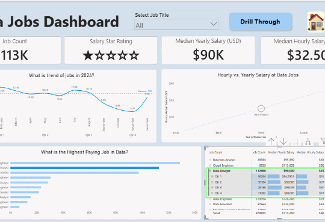

### 🃏 Cards — Job Count, Star Rating, Yearly Salary, Hourly Rate

#### Skill Demonstrated: 
Cards, DAX Measures & Custom Rating Logic

#### What it does:

#### Job Count Card:
Highlights the total number of job postings in the dataset or if a job title is selected from the drop down only that job title count is shown which gives users an immediate sense of market size.

#### Star Rating Card: 
Assigns a rating based on yearly salary using a custom DAX rule— a yearly salary threshold $75000 below = no rating (0 stars), above $150,000 = 5 stars, and in-between values scaled accordingly. This provides an instant visual signal of how favorable a role's compensation is.

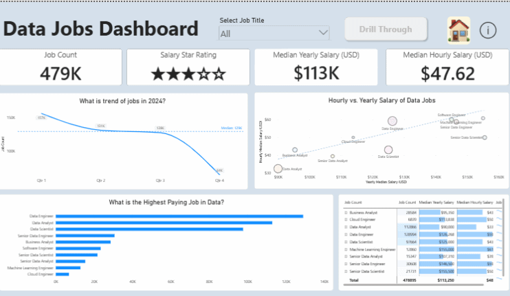

### Yearly Salary and Hourly Rate Card:
Shares yearly salary median and hourly rate median for a quick comparison.

### Dashboard Design:
Designed an interactive layout to tell the data story.

### Interactive Reporting:
#### Slicers: 
	Dropdpwn slicer was used so that users can select one or multiple job titles for a quick summary.

#### Drill Through Button:
	Based on users interest in particular job titles, they can further investigate nitty-gritty details. This button links to Drill Through page for a seamless navigation experience and it is a filtered link meaning when you click on a specific bar (e.g., "Data Analyst") and select "Drill Through" button the next page opens with context specifically for that job title. Note: multiple job titles can be selected from the dropdown slicer or directly from the bar chart.

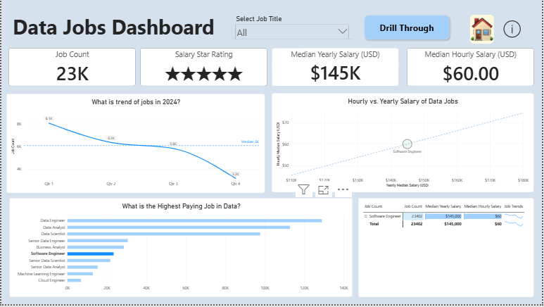
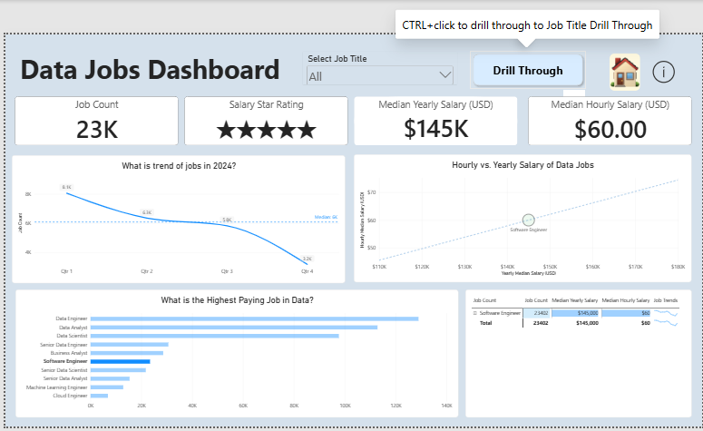

### 2.4. What I Learned from Data Job Dashboard Page
I learned how to effectively use Card visuals to display high-level 
metrics and how to utilize Matrix visuals to break down complex 
categorical data. I also learned the importance of using Slicers 
to make the report interactive and user-driven.
 
## 3. Page 2: Job Title Drill Through
#### 3.1. Objective
To provide a deep dive into a specific job title or multiple titles 
selected from the Data Jobs Dashboard page. This page answers detailed 
questions about benefits, work arrangements such as health insurance, 
work from home opportunity, which job platform, type of job available
for the job title. For example- for Data Analyst % of full-time, part-time
or contractual offers, salary specification over various countries
for making an educated decision for job seekers. 

#### 3.2. Skills Used
- Drill-Through Configuration: 
Setting up fields to pass filters between pages.

### 3.3. Charts

### 🃏 KPI Cards — Hourly Rate & Yearly Salary (with Averages)

#### Skill Demonstrated: 
KPI Design, Comparative Benchmarking.

#### What they do:

#### Hourly Rate Card: 
Displays the hourly rate alongside the average hourly rate for the filtered job titles, letting users instantly compare a specific role's rate against the market average computed from all jobsavailable in countries.

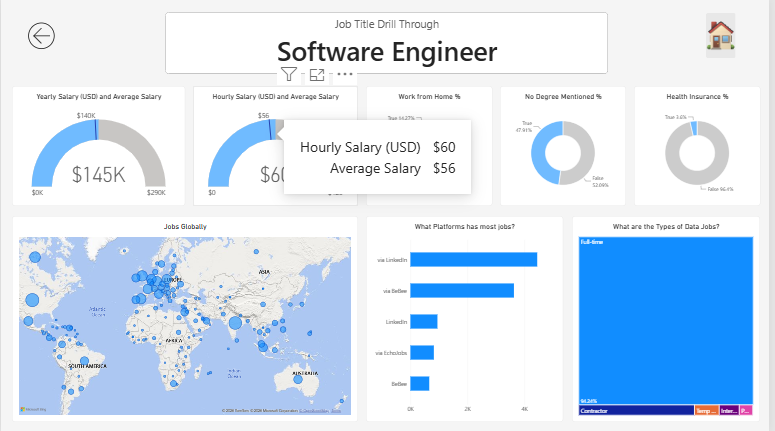

#### Yearly Salary Card: 
Displays the yearly salary alongside the average yearly salary, providing the same benchmark comparison at the annual level.

### 🍩 Donut Charts — Work From Home, Health Insurance & Degree Mentioned

#### Skill Demonstrated: Categorical Breakdown, Multi-Metric Segmentation & 
Filtered Context

#### What they do: 
Three separate donut charts, each filtered to the selected job titles.
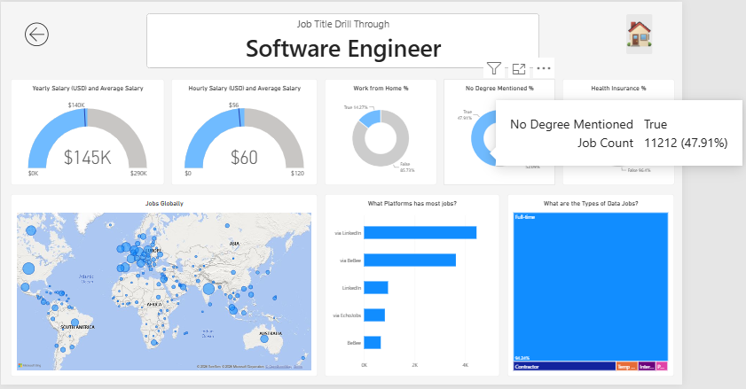
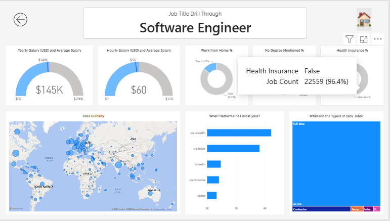
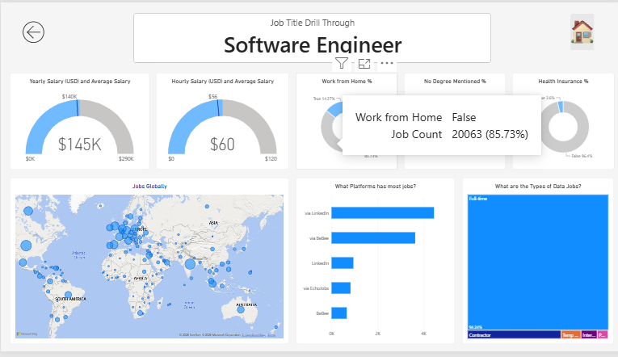

#### Work From Home — the % of postings offering remote work or not.

#### Health Insurance — the % of postings offering health insurance or not.

#### Degree Mentioned — the % of postings that explicitly require a degree orno degree mentioned.

### 🗺️ Map Visual — Job Density Across Countries

#### Skill Demonstrated: 
Geospatial Analysis & Density Mapping

#### What it does: 
Visualizes job density across various countries, using bubble size to show where data jobs are concentrated. This helps job seekers identify high-opportunity regions and evaluate relocation options.

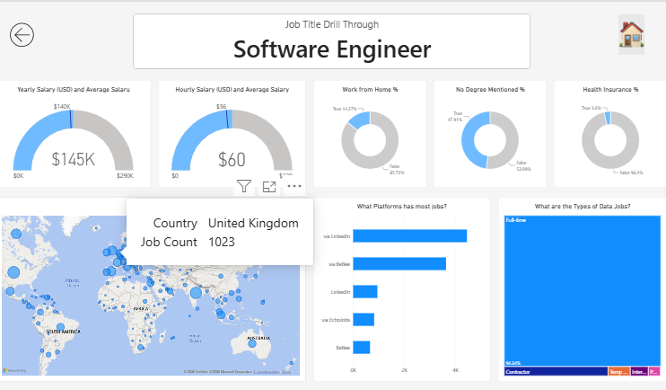

### 🌳 Treemap Chart — Job Type Distribution (% of Filtered Job Titles)

#### Skill Demonstrated: 
Part-to-Whole Analysis & Proportional Visualization

#### What it does: 
Displays the percentage breakdown of job types—such as full-time, part-time, contract, temp-work, internship etc. — for the filtered job titles. The size of each rectangle represents its share of total postings, making the dominant employment type instantly obvious.

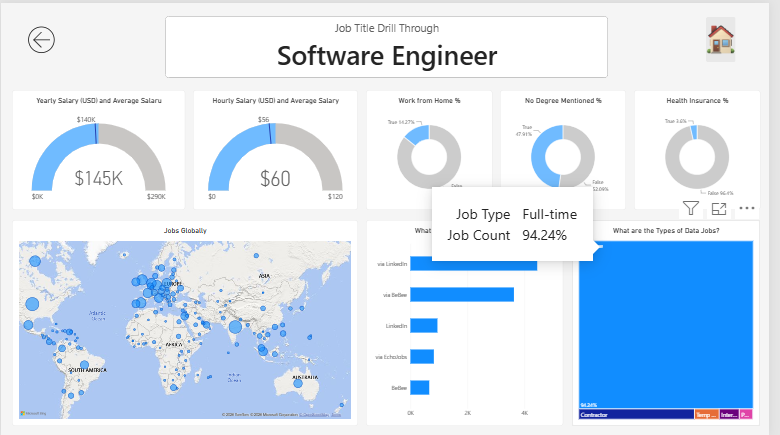

### 📊 Bar Chart — Job Platforms

#### Skill Demonstrated: 
Categorical Aggregation, Ranking & Source Distribution Analysis

#### What it does: 
Displays the job platforms (e.g., LinkedIn, Indeed, Glassdoor, company career pages) where the filtered job titles are posted, ranked by posting volume. This reveals which platforms host the most opportunities for a given role.

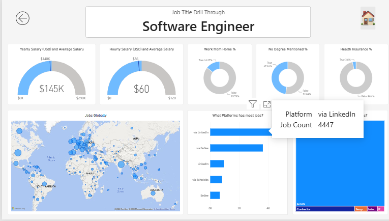

<< The "Back" button returns the user to the main overview page, 
preserving the filters they set initially.

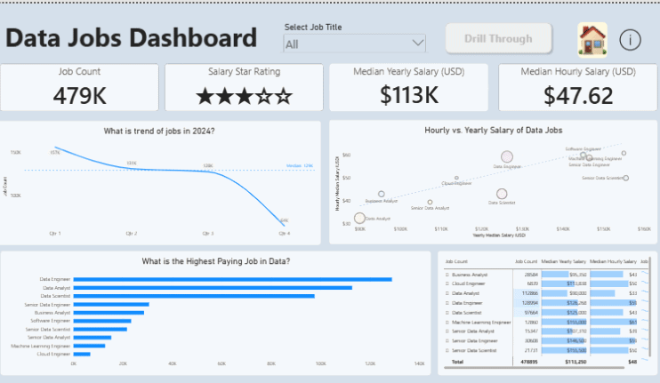

### 3.4. What I Learned from Job Title Drill Through Page 
I mastered the Drill-Through feature in Power BI, which is essential 
for creating hierarchical report structures. I also learned how to use 
Custom Tooltips and Cross-filtering to allow users to explore data 
at a granular level without leaving the page. Also home button and go 
back button addition makes navigating within the report very intuitive.

## 4. Summary & Conclusion
Through this project, I mastered building an interactive data narrative 
using Power BI's advanced features—Drill-Through, complex DAX calculations, 
time intelligence, conditional formatting, and sparklines—to transform 
raw job posting data into a decision-making tool. I learned that a 
dashboard is not just about displaying data, but about solving specific 
user pain points: identifying skill gaps, spotting seasonal hiring 
trends, comparing hourly vs. yearly compensation structures, and 
revealing geographic and platform-level opportunities for job seekers. 
Ultimately, this project taught me the importance of user-centric 
design—ensuring that every button, slicer, KPI card, and chart serves a 
clear purpose in helping the user navigate their career path with 
confidence.